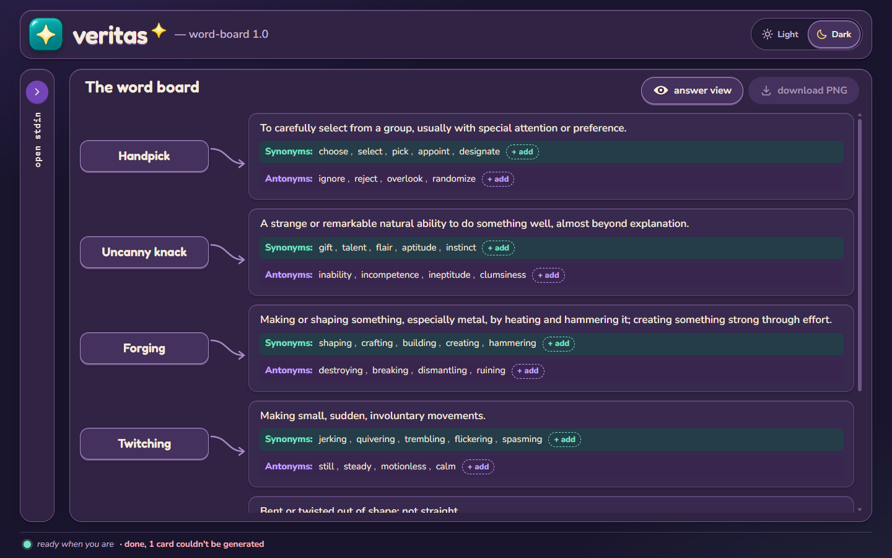
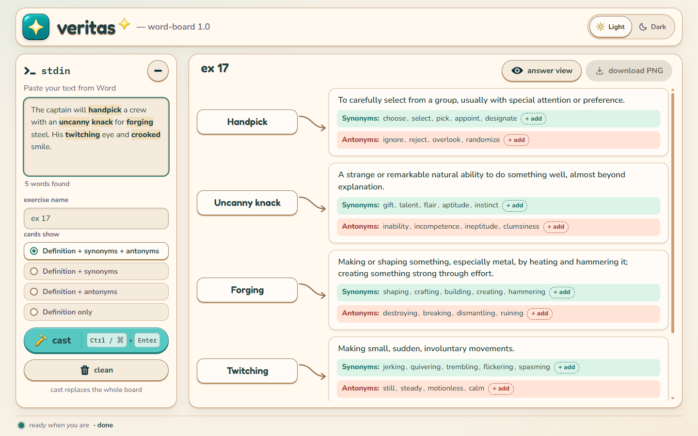
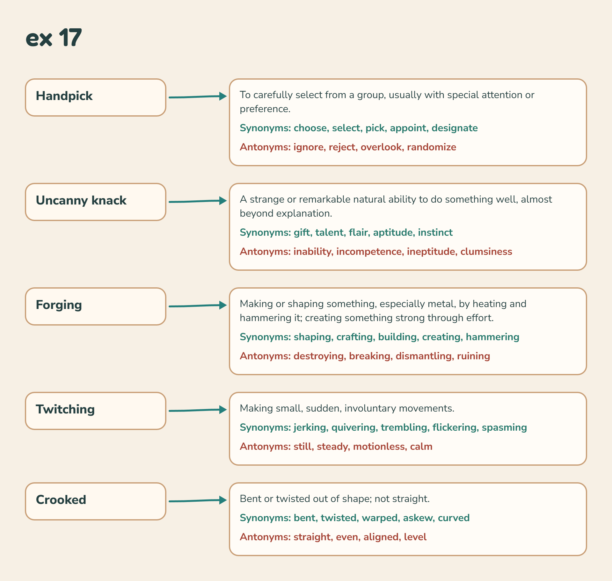
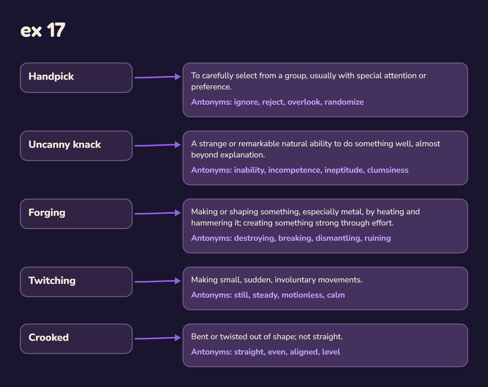

# veritas — word-board

A small board for English vocabulary homework. Paste a text from Word, and every word or phrase set in **bold** gets a card with its meaning (as used in that sentence), synonyms and antonyms. Edit anything by clicking it, then export the board as a PNG to hand in.

It is a sister project to [veritas-tf-board](https://github.com/troylights-stack/veritas-tf-board) and shares its look: two themes, **Daylight** and **Nightspell**.



| Daylight | PNG export (Daylight) | PNG export (Nightspell, antonyms only) |
|---|---|---|
|  |  |  |

## What it does

- **Finds the bold words for you.** Paste straight from Word; bold is kept, adjacent bold words join into one phrase (*Uncanny knack*), and a `**word**` fallback works for plain text.
- **Four card modes:** definition + synonyms + antonyms, definition + synonyms, definition + antonyms, definition only. Switching mode is instant and asks Claude nothing.
- **Meaning from context.** One request to Claude covers the whole text, and each word is defined as it is used in its sentence.
- **Click to edit.** Fix any word, meaning, synonym or antonym. A card Claude could not fill can be completed by hand.
- **PNG export** in the style of the app (current theme), with the exercise name on top. Long boards grow taller and nothing is cut off.
- **Answer view** that fits the whole board on one screen.
- Keyboard accessible, `prefers-reduced-motion` respected, works down to 320 px wide.

## How it runs

The page is a single self-contained HTML file published as a [claude.ai Artifact](https://claude.ai). It asks Claude through the artifact runtime (`sample`) on the viewer's own Claude account, so it needs no API key, and it saves the PNG through the runtime's `downloads` capability. Because of that it only works inside claude.ai; opening `dist/word-board.html` elsewhere shows the interface but cannot generate cards.

Nothing is stored between visits except the chosen theme.

## Develop

Plain HTML, CSS and JavaScript, no framework and no runtime dependencies. Node 18+ is needed for the tests and the build.

```bash
npm test          # unit tests for parsing, state, prompt handling and PNG layout
npm run build     # writes dist/word-board.html (everything inlined)
```

The logic lives in small modules under `src/` that work both as browser globals and as CommonJS, so the same code runs in the page and in the tests:

| File | Responsibility |
|---|---|
| `parse.js` | find bold words and their sentence in pasted Word HTML |
| `paste-clean.js` | sanitise pasted HTML down to paragraphs and bold |
| `modes.js`, `board-state.js` | card modes and immutable board state |
| `prompt.js` | build the request to Claude, normalise its reply |
| `png-layout.js`, `png-render.js` | board geometry and canvas rendering for the PNG |
| `board-view.js`, `app.js` | on-screen board, editing, wiring to Claude and downloads |

`tests/stub-claude.js` is a development-only fake of the claude.ai runtime for trying the page in a normal browser. The build never includes it.

The design and the build plan are in `docs/superpowers/`; the visual system comes from veritas-tf-board (`docs/reference/`).

## Licence

Code: MIT, see [LICENSE](LICENSE). The artwork in `assets/` (the wizard cat and icon sprites) is not covered by the MIT licence; all rights reserved by the repository owner.
